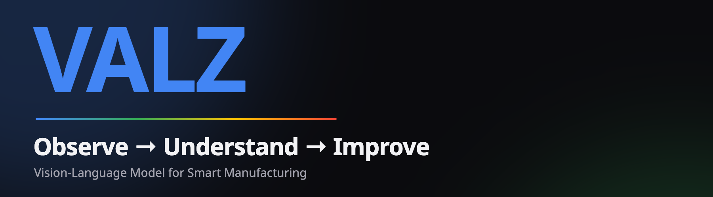
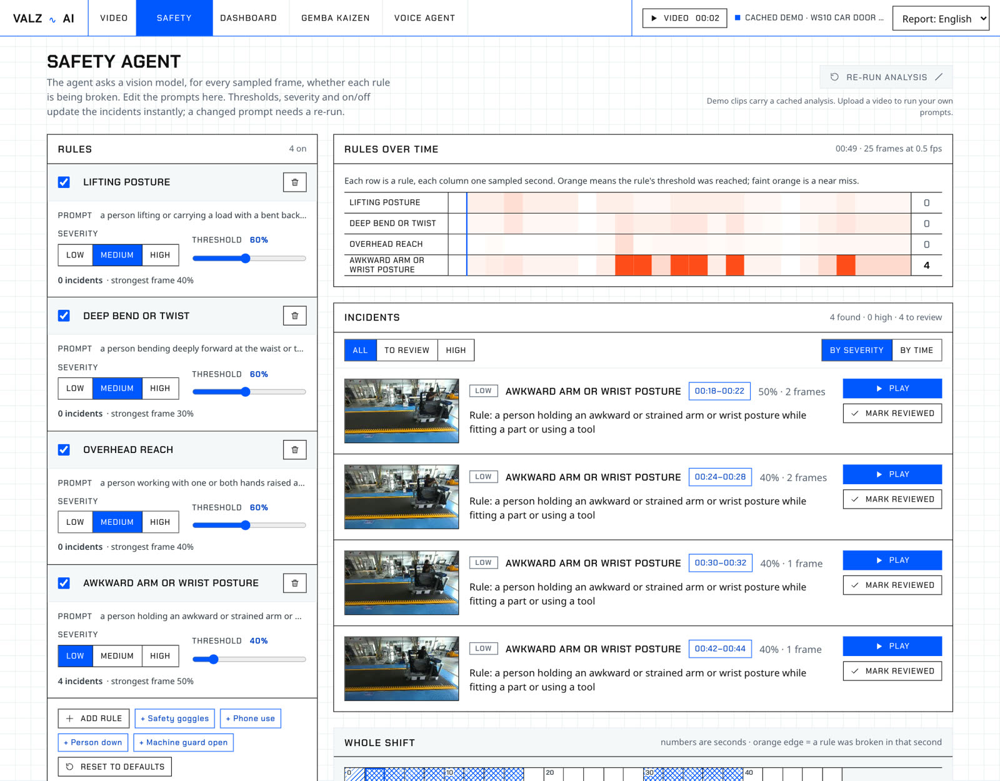
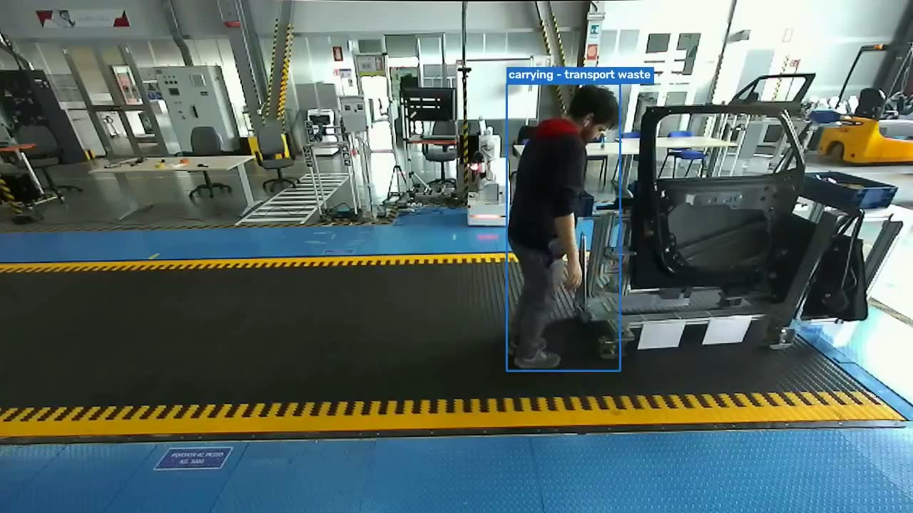
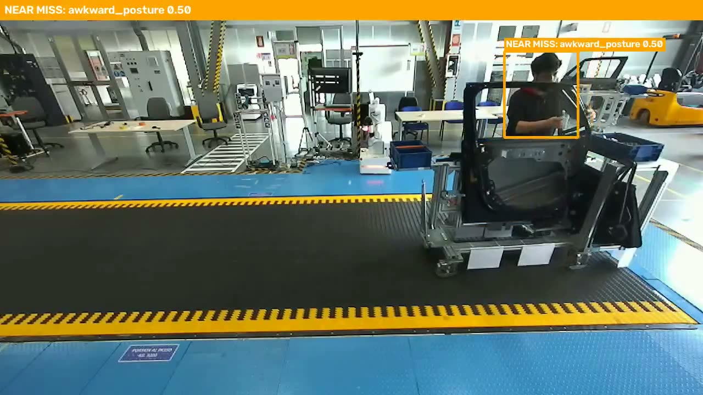
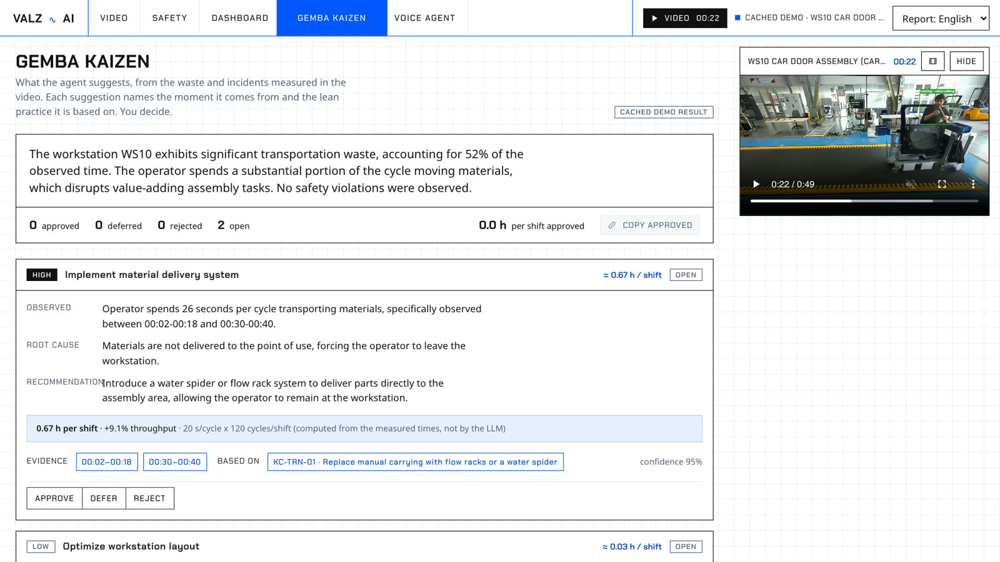
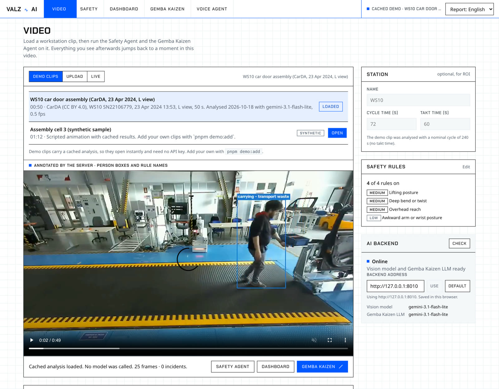
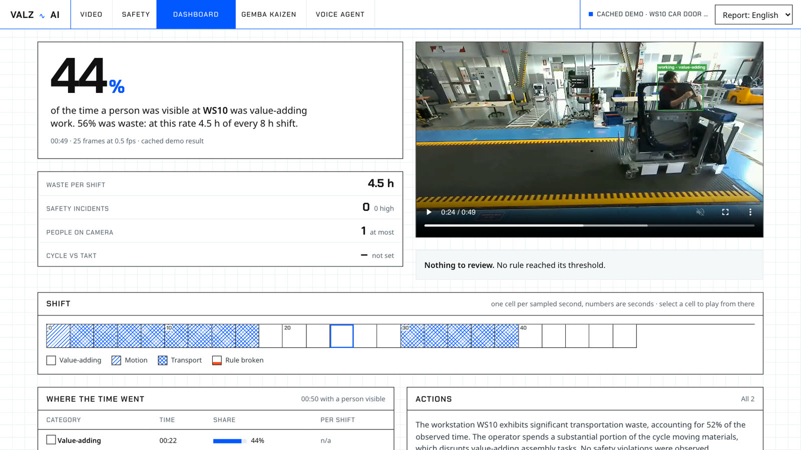
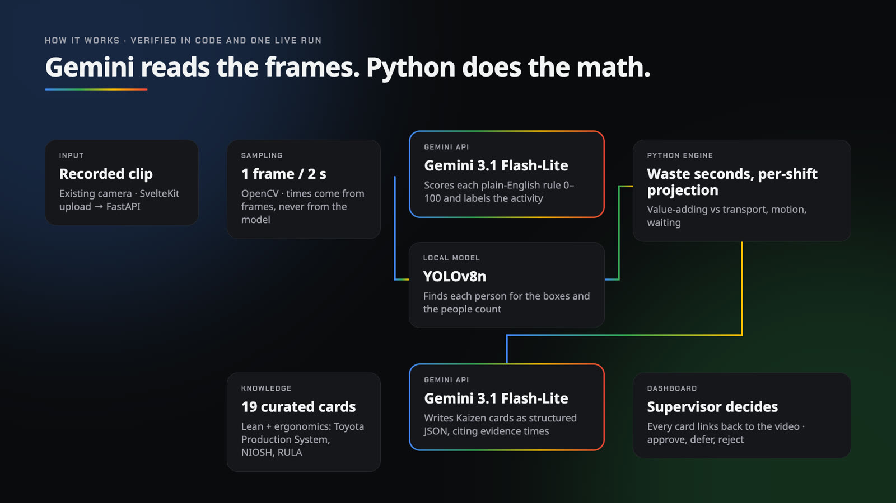
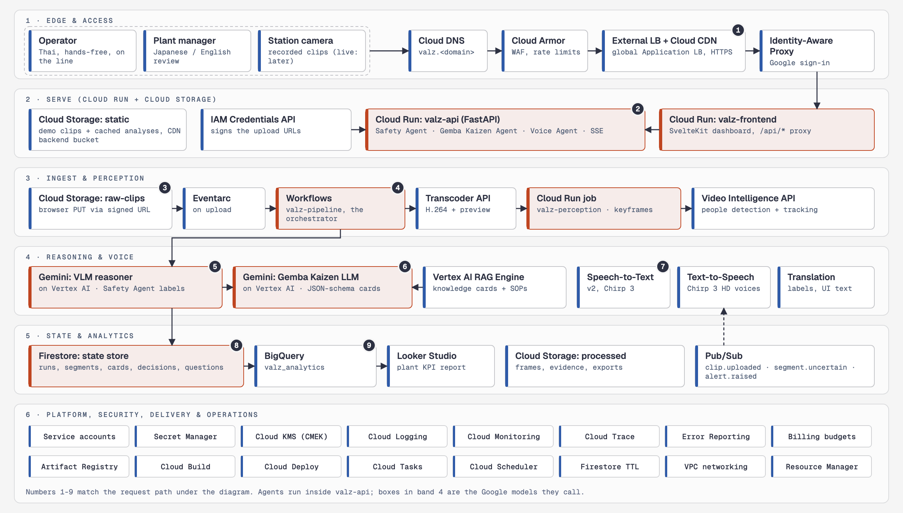
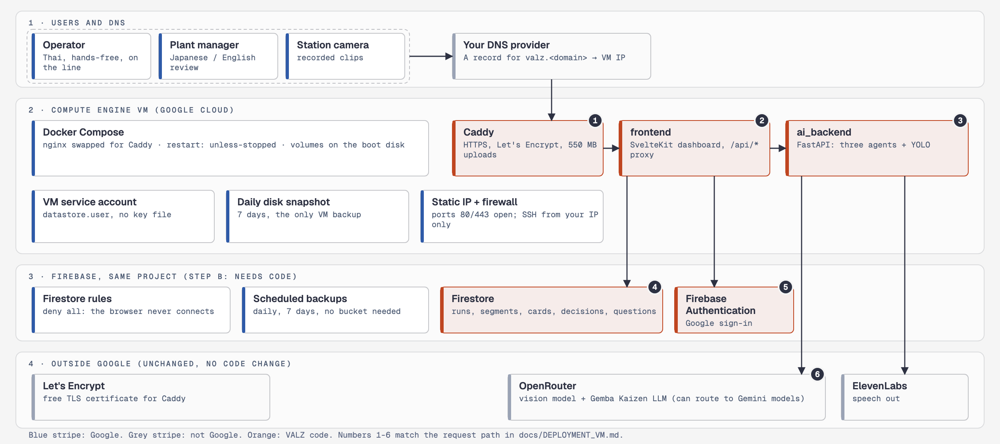

<p align="center">
  
</p>

<h1 align="center">VALZ</h1>

<p align="center"><b>Existing cameras. Actionable intelligence.</b></p>

<p align="center">
  
  
  
  
  <br>
  
  
  
  
  
</p>

VALZ turns ordinary factory camera footage into observations a supervisor can check and improvement proposals a team can act on.
A **Safety Agent** scores every sampled frame against safety rules written in plain English, and a **Gemba Kaizen Agent** measures
where the time went and writes Kaizen cards with evidence and an ROI estimate. Both run on **Gemini**. When the agent is not sure what
it saw, it does not guess: it writes a question for the operator.

> *The system says what it doesn't know, then asks the person who does.*

Team **TuiDui** · Google Cloud **AI Builder Cup 2026** · Manufacturing: Intelligent Operations & Industrial Efficiency



## What it does

| | |
|---|---|
|  |  |
| **Observe.** YOLO finds each person; Gemini labels what they are doing, frame by frame (blue: waste, green: value-adding). | **Understand.** Gemini scores each plain-English safety rule from 0 to 100. Near misses are amber and go to a person for review. |



**Improve.** The Gemba Kaizen Agent turns the measured waste into cards: what was seen, likely root cause, recommendation, the exact
moments in the video, and the lean reference it relied on. Gemini estimates the seconds saved; Python turns that into hours per shift
and throughput. The manager approves, defers or rejects each card.

On the bundled clip (CarDA dataset, workstation WS10, 50 s), VALZ found **26 s of transport waste** (moving the cart and fetching
parts, 52 % of the clip), proposed a **water spider or flow rack**, and flagged **four awkward-posture near misses** during door fitting.
No rule crossed its 60 % threshold, and the app says so.

| Video | Dashboard |
|---|---|
|  |  |

## How Google AI is used



| Step | What runs | Google |
|---|---|---|
| Rule scoring and activity labels | One request per sampled frame (0.5–1 fps), structured JSON output | **Gemini 3.1 Flash-Lite** via the **Gemini API** (Google AI Studio) |
| Kaizen cards, safety actions, operator questions | Strict JSON schema, grounded in 19 curated lean and ergonomics cards | **Gemini 3.1 Flash-Lite** via the **Gemini API** |
| Waste seconds, per-shift projection, ROI | Plain Python: times come from frame timestamps, never from the model | — |
| Person boxes and people count | YOLOv8n, local | — |
| Demo dashboard | Static SvelteKit build, cached demo clips | **Firebase Hosting** (or Cloud Run with the Dockerfile) |

The backend talks to any OpenAI-compatible endpoint, so the Gemini API is a setting, not a code path: see
[ai_backend/.env.example](ai_backend/.env.example) (`OPENROUTER_URL`, `VLM_MODEL`, `LSS_LLM_MODEL`, `LLM_MIN_INTERVAL_S` for the free tier).

## System architecture



Every layer runs on Google Cloud. The full architecture, with the request path, a table of every service and who deploys it,
team delegation, shared data contracts and the 24-hour build plan, is in
[docs/system_architecture.html](docs/system_architecture.html). There are two ways to deploy it, from a single VM with Firebase
to the fully managed design; see [Deploy on Google Cloud](#deploy-on-google-cloud).

> **Status.** The diagram is the target architecture. Today both agents run on Gemini 3.1 Flash-Lite through the Gemini API, the
> dashboard has a static demo build for Firebase Hosting, and the backend runs locally or on one VM with Docker Compose. Vertex AI, Workflows, Eventarc,
> Firestore, Pub/Sub and BigQuery are planned, not built. The Voice Agent still uses ElevenLabs. [Project status](#project-status) lists
> each piece.

### How a clip moves through Google Cloud

| Layer | Google Cloud services | What happens |
|---|---|---|
| **Edge** | Cloud DNS · Cloud Armor · External Application Load Balancer · Cloud CDN · Identity-Aware Proxy | One HTTPS address. Managers sign in with their Google account; static files and demo clips come from the CDN. |
| **Serve** | Cloud Run (`valz-frontend`, `valz-api`) · Cloud Storage | The SvelteKit dashboard and the FastAPI service that hosts the Safety, Gemba Kaizen and Voice agents. The API hands the browser a signed URL, and the clip uploads straight to Cloud Storage. |
| **Ingest and perception** | Cloud Storage · Eventarc · Workflows · Transcoder API · Cloud Run job · Video Intelligence API | A new clip fires Eventarc, which starts the `valz-pipeline` workflow. It transcodes the video, samples keyframes in a Cloud Run job and counts people with Video Intelligence. |
| **Reasoning and voice** | Vertex AI (Gemini, RAG Engine) · Speech-to-Text · Text-to-Speech · Cloud Translation | Gemini labels each keyframe as value-adding, a type of waste, or `UNCERTAIN`. The Gemba Kaizen Agent retrieves countermeasure cards from RAG Engine and writes the action cards. The Voice Agent asks and listens in the operator's language. |
| **State and analytics** | Firestore · Pub/Sub · BigQuery · Looker Studio | Runs, segments, cards and decisions live in Firestore; questions and alerts travel on Pub/Sub; approved cards flow to BigQuery for the plant-wide report. |
| **Platform** | IAM · Secret Manager · Cloud KMS · Artifact Registry · Cloud Build · Cloud Deploy · Cloud Logging, Monitoring, Trace, Error Reporting · Cloud Tasks · Cloud Scheduler · Billing budgets | One service account per service, so there are no API keys. Cloud Build deploys on every push to `main`. |

### The uncertainty loop

1. **Gemini** labels any segment with confidence below 0.75 as `UNCERTAIN` (a grey bar on the timeline).
2. **valz-api** publishes the segment id and timestamp to the Pub/Sub topic `segment.uncertain`.
3. **The Voice Agent** speaks the question to the operator in Thai with Text-to-Speech, hands-free, while they keep working:
   *"I saw a 4-second pause at 00:16. Did a part jam?"*
4. **Speech-to-Text** transcribes the answer, and it and its root cause are written to Firestore. The segment becomes `verified`.
5. **The Gemba Kaizen Engine** recalculates ROI, and the dashboard updates live over server-sent events.

### Example Gemba Kaizen Action Card

| Field | Value |
|---|---|
| Observation | Reach to Bin B in 100% of cycles (avg 2.4 s) |
| Recommendation | Move Bin B 25 cm closer to the fixture |
| Seconds saved per cycle | 1.6 |
| Cycles per shift | 1,346 (8 h × 3600 / 21.4 s cycle) |
| Hours saved per shift | 0.60 (1.6 × 1,346 / 3600) |
| Throughput gain | 8.1% (21.4 / 19.8 − 1) |

Segment classes are `VA`, `NVA_MOTION`, `NVA_TRANSPORT`, `NVA_WAITING`, `NVA_SEARCH`, `SAFETY_ERGO`, `SOP_DEVIATION` and `UNCERTAIN`.
A segment's status moves from `auto` to `needs_verification` to `verified`. The engine, not the model, computes the numbers.

## Deploy the demo dashboard (free)

The dashboard can be built as a static single-page app that opens the bundled demo clips with no backend. It is served from
**Firebase Hosting** on the free Spark plan (no billing account):

```bash
cd frontend
pnpm run build:static            # STATIC_DEMO=1 → build-static/ (adapter-static, SPA fallback)
firebase deploy --only hosting   # project in .firebaserc, config in firebase.json
```

Uploads, re-runs and the Voice Agent need the backend, so they report it as offline in this build.

## Deploy on Google Cloud

Two paths, from the fewest Google services to the most managed. Pick one; the second is where the first grows.

| | **Minimal: one VM + Firebase** | **Full: managed services** |
|---|---|---|
| Guide | [docs/DEPLOYMENT_VM.md](docs/DEPLOYMENT_VM.md) | [docs/DEPLOYMENT.md](docs/DEPLOYMENT.md) |
| Google products | Compute Engine, Firestore, Firebase Authentication, IAM | About 35: Cloud Run, Vertex AI, Workflows, Pub/Sub, Firestore, Cloud Storage, load balancer, IAP and more |
| Code changes | **None** for part A (the VM); sign-in and Firestore for part B | Replace OpenRouter, ElevenLabs, YOLO and ffmpeg with Google services |
| Models and speech | Unchanged: OpenRouter, ElevenLabs | Gemini, Speech-to-Text, Text-to-Speech, Video Intelligence |
| Scale | One VM, no failover | Autoscaling Cloud Run, event-driven pipeline |
| Best for | The hackathon, a pilot, one plant | Several plants, a managed pipeline |

### Minimal: one VM and Firebase



The Docker Compose stack in this repository runs on one Compute Engine VM, with Caddy for HTTPS ([docker-compose.https.yml](docker-compose.https.yml),
[deploy/Caddyfile](deploy/Caddyfile)). Part A needs no code changes. Part B adds Firestore for decisions that every manager sees and Firebase Authentication
for Google sign-in. Until part B exists the site has no sign-in, so the guide has you turn on a Caddy password first.

```bash
# on the VM, after DNS points at it (docs/DEPLOYMENT_VM.md, part A)
DOMAIN=valz.example.com docker compose -f docker-compose.yml -f docker-compose.https.yml up -d --build
```

### Full: managed services

[docs/DEPLOYMENT.md](docs/DEPLOYMENT.md) takes an empty project to a running system in 21 numbered sections, one per service or group
of services, each with what it does for VALZ, the tool that deploys it, the commands and a check.

| Section | Service | Deployed by |
|---|---|---|
| §0–§1 | Project, APIs, IAM service accounts | gcloud |
| §2 | Artifact Registry | gcloud |
| §3 | Cloud Storage | gcloud |
| §4 | Firestore | gcloud |
| §5 | Pub/Sub | gcloud |
| §6 | Secret Manager, Cloud KMS | gcloud |
| §7 | Vertex AI: Gemini | enable API and IAM, nothing to deploy |
| §8 | Vertex AI RAG Engine | Python script |
| §9 | Video Intelligence API, Transcoder API | enable API and IAM, nothing to deploy |
| §10 | Speech-to-Text, Text-to-Speech, Translation | gcloud for the recognizers; the others are enable-only |
| §11 | Cloud Run `valz-api` | Cloud Build |
| §12 | Cloud Run job `valz-perception` | Cloud Build |
| §13 | Workflows, Eventarc | gcloud |
| §14 | Cloud Run `valz-frontend` | Cloud Build |
| §15 | Load balancer, Cloud CDN, Cloud Armor, IAP, Cloud DNS | gcloud and one console step |
| §16 | BigQuery, Looker Studio | `bq`; Looker Studio in its UI |
| §17 | Cloud Tasks, Cloud Scheduler | gcloud |
| §18 | Cloud Build, Cloud Deploy | one trigger, then every push |
| §19 | Logging, Monitoring, Trace, Error Reporting, budgets | automatic plus gcloud |
| §20–§21 | End-to-end check, tear down | — |

The commands in both guides have not been run against a live project; check flags with `gcloud <command> --help`. The Compose override
and the Caddy configuration for the VM path were validated with `docker compose config` and `caddy validate`.

## Project status

| Node | Component | Owner | Today | On Google Cloud | Status |
|---|---|---|---|---|---|
| 00 | Workstation clips (before / after) | P5 | — | Cloud Storage `static` and `raw-clips` | Planned |
| 01 | Frame sampling and people counting | P1 | OpenCV, YOLOv8 in [ai_backend/](ai_backend) | Cloud Run job + Video Intelligence API | **Built** locally |
| 02 | Per-frame action detection | P1 | Gemini 3.1 Flash-Lite (Gemini API); BLIP + MiniLM fallback | Gemini on Vertex AI | **Built** |
| 01 · 03 | Safety Agent: safety rules and Muda timeline | P1 | Gemini 3.1 Flash-Lite (Gemini API) | Gemini on Vertex AI | **PoC**, verified live |
| 04 · 06 | Gemba Kaizen Agent: engine metrics, knowledge cards, ROI | P1 | Gemini 3.1 Flash-Lite (Gemini API), `knowledge/lss_cards.json` | Gemini + Vertex AI RAG Engine | **PoC**, verified live |
| 03 · 04 | SOP and Muda prompt pack | P2 | — | RAG Engine corpus | Planned |
| 05 | Orchestrator | P3 | in-process | Eventarc + Workflows | Planned |
| 06 · 07 | Engine and State Store | P3 | engine in Python; browser storage and SQLite | engine unchanged; Firestore | Engine **PoC**, store Planned |
| 08 | Voice Agent | P4 | ElevenLabs | Speech-to-Text, Text-to-Speech, Translation | **PoC** |
| 09 | Dashboard: Video, Safety Agent, Dashboard, Gemba Kaizen and Voice pages, with a mock mode | P5 | SvelteKit in [frontend/](frontend) | Cloud Run + load balancer | **Integrated** |
| — | Hosting, CI/CD, IAM, observability | P3 | Static demo build for Firebase Hosting; full stack with Docker Compose | the Google Cloud services above | Demo build **ready**, rest planned |

## Repository layout

```
.
├── ai_backend/        Python service: FastAPI, Safety / Gemba Kaizen / Voice agents, YOLO, BLIP
│   ├── server.py              API (Swagger at /docs, spec in openapi.json)
│   ├── video_action_model.py  BLIP captioning + MiniLM prompt matching → action segments
│   ├── vlm_action_model.py    Vision-model Yes/No per frame → action segments
│   ├── safety_agent.py        Safety Agent: safety rules + activity (Muda) timeline
│   ├── lss_agent.py           Gemba Kaizen Agent: metrics + knowledge cards + LLM → cards with ROI
│   ├── voice_agent.py         Voice Agent: RAG chat with speech in and out
│   ├── openrouter_client.py   LLM client (the file the Vertex AI client replaces)
│   ├── knowledge/             Countermeasure knowledge cards (first RAG Engine corpus)
│   ├── static/demo.html       Upload page for the VALZ pipeline (served at /demo)
│   ├── person_count_model.py  YOLOv8n person counting
│   ├── schemas/               JSON Schemas of the model outputs
│   └── tests/                 pytest (fake models, no downloads)
├── frontend/          Dashboard: SvelteKit (adapter-node); /api/* proxies to the API; demo clips in static/demo
├── PRODUCT.md         Product record (users, purpose, constraints) for design work
├── DESIGN.md          The dashboard's design system
├── docs/
│   ├── system_architecture.html  Architecture on Google Cloud, service map, delegation, contracts
│   ├── DEPLOYMENT_VM.md          Minimal deployment: one VM + Firebase
│   └── DEPLOYMENT.md             Full deployment: per-service guide
├── deploy/
│   ├── nginx.conf     nginx for local Docker Compose
│   ├── Caddyfile      HTTPS for the one-VM deployment (replaces nginx)
│   ├── vm-startup.sh  Compute Engine startup script: installs Docker and git
│   └── firebase/      Firestore rules, indexes and firebase.json (deny-all rules; the server uses the Admin SDK)
├── docker-compose.yml        Full system: nginx → frontend → ai_backend (local development)
├── docker-compose.https.yml  Override for the VM: Caddy instead of nginx, HTTPS on 80 and 443
└── images/            Architecture diagrams (full and minimal)
```

## Run it locally

Local development does not need a Google Cloud project. Point the backend at the Gemini API with a Google AI Studio key (or at OpenRouter);
the Voice Agent's speech uses ElevenLabs.

```
browser ──► nginx :80 ──► frontend (SvelteKit, :3000) ──► /api/* proxy ──► ai_backend (FastAPI, :8000) ──► OpenRouter
                 └─ /docs, /redoc, /openapi.json ─────────────────────────► ai_backend
```

```bash
cp ai_backend/.env.example ai_backend/.env      # set the API key, and OPENROUTER_URL + Gemini model ids for the Gemini API
docker compose up --build                       # http://localhost  (API docs: http://localhost/docs)
```

The browser only talks to the frontend. Its server route [`/api/[...path]`](frontend/src/routes/api/[...path]/+server.ts)
streams requests (including video uploads) to `AI_BACKEND_URL` (`http://api:8000` in Compose), so ai_backend needs no CORS
setup and is not exposed except for its API docs. Uploads up to 550 MB and 15-minute analyses are allowed end to end.
On Google Cloud the upload goes straight to Cloud Storage instead, because Cloud Run limits request bodies to 32 MiB.

### AI backend

Given a video and a prompt such as `person running`, the perception service returns when the action happens (BLIP captions
matched with `all-MiniLM-L6-v2` embeddings) and how many people are in frame (YOLOv8 nano). The Safety Agent and the Gemba Kaizen
Agent build on a vision model and an LLM.

```bash
cd ai_backend
uv venv --python 3.13 .venv && uv pip install -r requirements.txt
.venv/bin/python -m spacy download en_core_web_sm
.venv/bin/python server.py --port 8000          # Swagger UI: http://localhost:8000/docs
```

See [ai_backend/README.md](ai_backend/README.md) for every endpoint, parameter, environment variable and response schema.

### Frontend

The dashboard has five pages: **Video** (upload a clip, pick a bundled demo clip, or replay one as a simulated live feed),
**Safety** (review incidents and edit the safety rules' prompts, severity and thresholds), **Dashboard** (the shift in one
screen), **Gemba Kaizen** (the agent's suggestions with ROI, evidence and cited sources; approve, defer or reject each) and **Voice Agent**
(ask questions about the shift by voice or text; answers are read aloud). Demo clips carry a cached analysis, so everything
works with no backend and no API key; `pnpm demo:add` analyses your own clip once and adds it to the list.
See [frontend/README.md](frontend/README.md).

```bash
cd frontend
corepack enable                 # provides pnpm
pnpm install
cp .env.example .env            # AI_BACKEND_URL (default http://localhost:8000)
pnpm run dev                    # http://localhost:5173 (start ai_backend on :8000 first)
```

| Command | What it does |
|---|---|
| `pnpm run check` | Type-check with `svelte-check` |
| `pnpm run lint` | Prettier check |
| `pnpm run test:unit --run` | Vitest (component tests run in headless Chromium) |
| `pnpm exec playwright test` | End-to-end tests |
| `pnpm run build` | Production build |

## CI/CD

The target is Cloud Build: a trigger on `main` builds the three images, pushes them to Artifact Registry and runs
`gcloud run deploy`; Cloud Deploy can add a staging-to-production promotion ([guide §18](docs/DEPLOYMENT.md#18-cloud-build-and-cloud-deploy)).
The repository has no CI workflow yet; run the checks above and `pytest` in `ai_backend` before you push.

## Team

**TuiDui**: Ratchanon Buachum (team leader), Sawit Koseeyaumporn, Wayu Tharai.

Planned ownership on the target architecture:

| Owner | Role | Google Cloud services |
|---|---|---|
| P1 | Vision pipeline engineer | Cloud Storage ingest · Transcoder API · Cloud Run job · Video Intelligence API |
| P2 | Gemini prompts, Muda reasoning | Gemini on Vertex AI · RAG Engine |
| P3 | Backend, orchestration, platform | Cloud Run `valz-api` · Workflows · Eventarc · Firestore · Pub/Sub · BigQuery · IAM · Cloud Build |
| P4 | Voice agent engineer | Speech-to-Text · Text-to-Speech · Translation |
| P5 | Dashboard, edge, demo and pitch | Cloud Run `valz-frontend` · load balancer · Cloud CDN · Cloud Armor · IAP · Looker Studio |

## Credits

Demo footage: CarDA (Car Door Assembly dataset), workstation WS10, licensed [CC BY 4.0](https://creativecommons.org/licenses/by/4.0/); credit the CarDA authors when sharing.
Lean and ergonomics references are listed with each card in [ai_backend/knowledge/lss_cards.json](ai_backend/knowledge/lss_cards.json).
